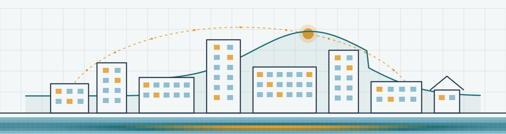
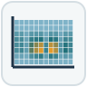

Glazer3S is a small consulting firm that helps with building energy modeling software development,
studies using large parametric analyses, and related ASHRAE standards.

I'm Jason Glazer, the principal of Glazer3S, and I have extensive experience in these areas and more.

**[Contact me](mailto:jason@glazer3s.com?subject=Glazer3S%20inquiry)** to discuss your project.

#  Software

- EnergyPlus new features and enhancements
- Rapid EnergyPlus bug fixes
- Customizations and fixes to EP-Launch, IDF Editor, epJSON Editor, and other EnergyPlus utilities
- Python scripting to help your simulation workflow
- Custom desktop, web-based, and app solutions
- Direct user support for EnergyPlus on your timeframe

#  Simulation

- Evaluate technologies across cities and typical buildings
- Evaluate building energy code changes across cities
- Review and fix EnergyPlus input files
- Create or review prototypical building models
- Create tariff descriptions for EnergyPlus
- Create custom output reports for EnergyPlus
- Perform many thousands of simulation permutations

#  Standards

- Enhance ASHRAE Standards related to simulation, including 90.1, 140, 205, 209, 229P, and 232
- Develop and facilitate changes to other ASHRAE Standards
- Help obtain consensus and provide technical support during standards development
- Chair working groups or standards committees
- Review ASHRAE Standards and provide feedback and comments

# About Me

I was previously one of the owners and the president of GARD Analytics, Inc., which for over 35 years
had a customer-first approach to consulting. I proudly continue that approach at Glazer3S.

<!-- Optional: add a sentence or two about your ASHRAE committee roles and EnergyPlus development history here. -->

<!--

# Selected Work

Optional: add two or three short examples of past projects, for example:
- Added [feature] to EnergyPlus for [client or program]
- Ran [number] simulations to evaluate [technology or code change] across [number] cities
- Chaired the development of ASHRAE Standard [number]
Mention clients by name only with their permission. Delete this section if you prefer not to use it.
-->

# More Information

See my [LinkedIn profile](https://www.linkedin.com/in/jasonglazerengineer/) for my full experience, or email me to request a resume.
You can also find my open-source work on [GitHub](https://github.com/JasonGlazer).

Email me at [jason@glazer3s.com](mailto:jason@glazer3s.com?subject=Glazer3S%20inquiry) for more information.
